# 🎙️ Phase-by-Phase Implementation Plan: Upgrading to 1-Second Caller Voice Pack (B1 – O75)

> **Goal**: Replace the legacy 3-second audio voice pack with the client's new, fast 1-second voice pack (`Audio-new/`), guaranteeing **zero errors**, **zero legacy cache retention ("no cache, no old voice")**, and **100% synchronization across all Telegram Mini App entry links**.

---

## 🧭 Multi-Phase Overview & Architectural Safety

```mermaid
flowchart TD
    subgraph P1["Phase 1: Pre-Flight Audit & Safety Backups"]
        Audit["1. Audit Audio-new (75 files 1-75)"]
        Backup["2. Snapshot Backups (Audio/ & public/)"]
    end

    subgraph P2["Phase 2: Master Renaming & Normalization"]
        Rename["3. Normalize Audio-new (B1...O75)"]
        SyncRepo["4. Populate Master Audio/ Folder"]
        LinuxGuard["5. Generate Linux Case-Insensitive Aliases"]
    end

    subgraph P3["Phase 3: Public & Multi-Format Sync"]
        SyncPublic["6. Write 3 Formats into public/assets/audio/am & en"]
        PreserveFX["7. Preserve Non-Ball Audio (start.mp3)"]
    end

    subgraph P4["Phase 4: Multi-Layer Zero-Cache Guarantee"]
        RamCache["8. Clear Sound Engine In-Memory RAM Cache"]
        QueryBust["9. Bump AUDIO_PACK_VERSION = v4_fast_caller_20261104_1"]
        ViteHash["10. Vite Asset Chunk Re-Hashing"]
        HTMLNoStore["11. HTML no-cache, no-store Enforcement"]
    end

    subgraph P5["Phase 5: Global App Link Synchronization"]
        MenuBtn["12. Telegram Chat Menu Button (/play)"]
        ChannelPosts["13. Channel Broadcast URLs (@lomibingo_official)"]
        DbSync["14. Database Admin Settings (telegram_webapp_url)"]
    end

    subgraph P6["Phase 6: Automated Testing & Verification"]
        TestHarmonize["15. Run test_voice_url_harmonization.ts"]
        TestChannel["16. Run test_channel_post_url.ts"]
        TscCheck["17. Run npx tsc --noEmit"]
    end

    subgraph P7["Phase 7: Production Build & Cloudflare Deployment"]
        ViteBuild["18. npm run build (Syncs dist/assets/audio/)"]
        Cloudflare["19. Cloudflare Edge CDN Instant Propagation ($0/mo)"]
    end

    P1 --> P2 --> P3 --> P4 --> P5 --> P6 --> P7
```



---

## 📋 Phase 1: Pre-Flight Integrity Audit & Dual Safety Backups

### 1.1 Source Integrity Verification (`Audio-new/`)
Before modifying any files, verify:
- **Exact File Count**: Must be exactly **75 files**.
- **Number Coverage**: 100% coverage of balls 1 to 75 without gaps or duplicate numbers.
- **Audio Headers**: Valid MPEG-1 Audio Layer III (`ID3\x04` header).
- **Duration**: ~1.0 second per ball (~20 KB to 37 KB).

### 1.2 Dual Safety Backups
Create a timestamped snapshot of the current working audio state:
1. `backups/audio_backup_v3_20261104/Audio/` (Current repo audio files).
2. `backups/audio_backup_v3_20261104/public_am/` (Current public Amharic audio files).

> [!NOTE]
> Rollback Guarantee: If any regression occurs, restoring these directories reverts the system to the previous working state in under 30 seconds.

---

## 🏷️ Phase 2: Master Renaming & Normalization (B1 to O75)

### 2.1 File Name Normalization
Files in `Audio-new/` currently have varied download naming (e.g., `1.mp3`, `10 (1).mp3`, `71 (1).mp3`).
The automated migration script [`scripts/rename_and_sync_new_voice.mjs`](file:///c:/Users/asefa/Desktop/lomi-bingo/scripts/rename_and_sync_new_voice.mjs) maps every file to its official Bingo letter-number format:

| Column | Number Range | Source Raw Name | Canonical Name |
| :---: | :---: | :---: | :---: |
| **B** | 1 – 15 | `1.mp3` ... `10 (1).mp3` ... `15 (1).mp3` | `B1.mp3` – `B15.mp3` |
| **I** | 16 – 30 | `16 (1).mp3` ... `20.mp3` ... `30 (1).mp3` | `I16.mp3` – `I30.mp3` |
| **N** | 31 – 45 | `31 (1).mp3` ... `35.mp3` ... `45 (1).mp3` | `N31.mp3` – `N45.mp3` |
| **G** | 46 – 60 | `46.mp3` ... `50 (1).mp3` ... `60 (1).mp3` | `G46.mp3` – `G60.mp3` |
| **O** | 61 – 75 | `61 (1).mp3` ... `71 (1).mp3` ... `75.mp3` | `O61.mp3` – `O75.mp3` |

### 2.2 Linux Edge Case-Sensitivity Guard
On Linux hosting environments (Render and Cloudflare), file paths are strictly case-sensitive.
To eliminate 404 errors for any legacy or direct references, the script generates both uppercase and lowercase aliases in `Audio/` and `public/assets/audio/am/`:
- Uppercase: `B1.mp3` ... `O75.mp3`
- Lowercase: `o61.mp3` ... `o75.mp3`, `i17.mp3` ... `i30.mp3`, `n43.mp3` ... `n45.mp3`

---

## 📂 Phase 3: Public Asset Synchronization & Multi-Format Support

### 3.1 Triple-Alias Writing in `public/assets/audio/am` & `public/assets/audio/en`
The frontend sound engine in [`src/services/soundEngine.ts`](file:///c:/Users/asefa/Desktop/lomi-bingo/src/services/soundEngine.ts#L157-L160) queries:
```typescript
public getBallAudioUrl(num: number): string {
  const lang = this.voiceLang || 'am';
  return `/assets/audio/${lang}/${num}.mp3?v=${AUDIO_PACK_VERSION}`;
}
```
For 100% interoperability with all existing code, HTML test pages, and direct asset fetches, each ball is written in 3 filename formats:
1. **Primary Number**: `${num}.mp3` (e.g. `1.mp3`, `75.mp3`)
2. **Column Prefix**: `${col}${num}.mp3` (e.g. `B1.mp3`, `O75.mp3`)
3. **Hyphenated**: `${col}-${num}.mp3` (e.g. `B-1.mp3`, `O-75.mp3`)

### 3.2 Non-Ball Sound FX Preservation
Verify that non-ball sound assets (`start.mp3`, `start.webm`, `README.md`) are preserved untouched.

---

## ⚡ Phase 4: Multi-Layer Zero-Cache Guarantee ("No Cache, No Old Voice")

Telegram Mini Apps and mobile WebViews aggressively cache audio files. To ensure **zero players hear the old voice**, we enforce a 5-layer cache invalidation barrier:

| Cache Layer | Potential Risk | Invalidation Mechanism | Status |
| :--- | :--- | :--- | :---: |
| **Layer 1: Web Audio RAM** | Browser memory keeps decoded old AudioBuffers | `audioBufferCache.clear()` and `preloadedAudios.clear()` invoked on engine init | 🛡️ Secured |
| **Layer 2: Browser / WebView** | OS-level HTTP caching of MP3 files | Bump version query param: `?v=v4_fast_caller_20261104_1` in `soundEngine.ts` | 🛡️ Secured |
| **Layer 3: Vite JS Bundle** | Browser caches old JavaScript bundle | `npm run build` generates new chunk hashes (e.g., `index-D9zF1a.js`) | 🛡️ Secured |
| **Layer 4: HTML Entry Point** | Browser caches `index.html` referencing old JS | `public/_headers` enforces `Cache-Control: no-cache, no-store, must-revalidate` for `index.html` | 🛡️ Secured |
| **Layer 5: Cloudflare CDN** | Cloudflare Edge CDN caches assets | Cloudflare evaluates full URL with query string; `?v=v4_...` triggers a clean edge fetch | 🛡️ Secured |

### Code Update in `src/services/soundEngine.ts`:
```typescript
// Bump version constant
export const AUDIO_PACK_VERSION = 'v4_fast_caller_20261104_1';
```

---

## 🔗 Phase 5: Global App Link & Entry-Point Synchronization

To satisfy **"all the app link the app have to get the update"**, all Telegram Mini App entry points must point to the updated Cloudflare deployment:

### 5.1 Telegram Chat Menu Button (`setChatMenuButton`)
- Handled by [`server/services/telegramBotService.ts`](file:///c:/Users/asefa/Desktop/lomi-bingo/server/services/telegramBotService.ts#L177).
- Configures the persistent blue `[ ☰ Menu ]` / `🎮 Play Bingo` button beside the Telegram message input.
- Target URL: `https://bingo-mini-app.asefaeyob962.workers.dev` (or configured Cloudflare domain).

### 5.2 Direct Bot Links & In-App Play Link
- Native direct link: `https://t.me/LomiBingobot/play`
- Referral & campaign links: `https://t.me/LomiBingobot?startapp=ref_XXXXX`
- When clicked, Telegram immediately opens the fresh Cloudflare WebApp bundle.

### 5.3 Channel Promotional Broadcasts (`@lomibingo_official`)
- In [`server/services/telegramBotService.ts`](file:///c:/Users/asefa/Desktop/lomi-bingo/server/services/telegramBotService.ts#L585-L600), promotional messages sent to the official Telegram channel generate inline keyboard buttons pointing directly to the native Mini App URL (`https://t.me/<bot>/play`).
- Verified zero references to stale Render URLs.

### 5.4 Database Configuration (`admin_settings`)
- Ensure `telegram_webapp_url` in Neon PostgreSQL is set to the Cloudflare production URL via [`server/scripts/sync_webapp_url.ts`](file:///c:/Users/asefa/Desktop/lomi-bingo/server/scripts/sync_webapp_url.ts).

---

## 🧪 Phase 6: Automated Test Verification & Audit

Run the automated test pipeline to prove zero regressions:

1. **Voice URL & Version Harmonization Test**:
   ```bash
   npx tsx server/test_voice_url_harmonization.ts
   ```
   *Asserts `AUDIO_PACK_VERSION === 'v4_fast_caller_20261104_1'` and verifies cache-busting URLs for balls 1, 75, and phrases.*

2. **Channel Post URL Verification**:
   ```bash
   npx tsx server/scripts/test_channel_post_url.ts
   ```
   *Verifies channel buttons use native in-app links and zero stale endpoints.*

3. **TypeScript Type Safety**:
   ```bash
   npx tsc --noEmit
   ```
   *Confirms zero compile or type errors.*

4. **Multi-Room & Night Safety Guards**:
   ```bash
   npx tsx server/scripts/test_night_zero_bot_waiting.ts
   npx tsx server/scripts/test_room10_hourly_schedule.ts
   ```
   *Ensures core game mechanics remain 100% compliant with project rules.*

---

## 🚀 Phase 7: Production Build & Cloudflare Deployment

1. **Vite Production Build**:
   ```bash
   npm run build
   ```
   - Compiles client bundle into `dist/`.
   - Copies all newly synchronized audio files from `public/assets/audio/` into `dist/assets/audio/`.
   - Re-hashes JavaScript and CSS bundles.

2. **Edge Asset Verification**:
   - Verify `dist/assets/audio/am/1.mp3` through `dist/assets/audio/am/75.mp3` match the new 1-second file sizes (~20–37 KB).
   - Confirm Cloudflare Pages/Workers serves the new build with $0.00 bandwidth costs.

3. **Git Synchronization**:
   - Push updates to both GitHub remotes:
     ```bash
     git push origin main
     git push tycons-origin main
     ```

---

## ⏱️ Execution Checklist

| Phase | Description | Status |
| :---: | :--- | :---: |
| **P1** | Audit `Audio-new/` (75 files) & create timestamped backups | ✅ **Completed** |
| **P2** | Run automated renaming script (`B1.mp3`–`O75.mp3`) with Linux case guards | ✅ **Completed** |
| **P3** | Populate `public/assets/audio/am` & `en` with 3 alias formats | ✅ **Completed** |
| **P4** | Bump `AUDIO_PACK_VERSION` to `v4_fast_caller_20261104_1` & clear RAM cache | ✅ **Completed** |
| **P5** | Harmonize Telegram Menu Button & Channel post links | ✅ **Completed** |
| **P6** | Run automated test suites & `npx tsc --noEmit` | ✅ **Completed** |
| **P7** | Build `dist/`, verify files, and push to remotes | ✅ **Completed** |
