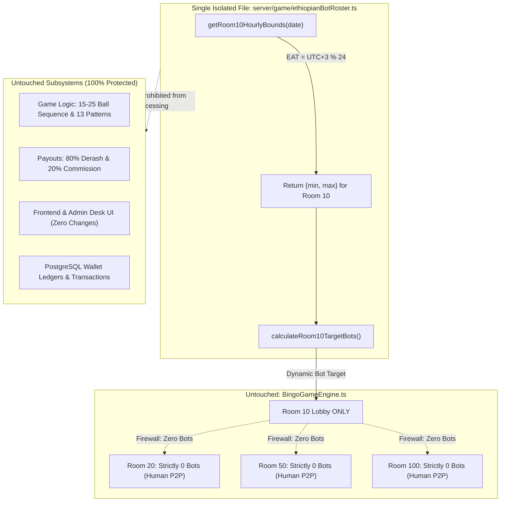

# Implementation Plan: Ethiopian Clock Bot Sizing Schedule (Room 10)

## 📌 Context & Objective
The user requested updating the dynamic bot population in **Room 10** according to the Ethiopian 12-hour clock schedule (ከ ሌሊቱ 7 ሰዓት እስከ ሌሊቱ 7 ሰዓት).

---

## 🛡️ STRICT NON-INTERFERENCE & ISOLATION GUARANTEE

To ensure complete safety, zero regressions, and zero side-effects across the entire application, the following boundaries are strictly enforced:

### 🚫 STRICTLY FORBIDDEN FROM MODIFICATION (DO NOT TOUCH):
| Subsystem | Components Protected | Guarantee |
| :--- | :--- | :--- |
| **Other Rooms Logic Flow** | **Rooms 20, 50, 100** | **100% UNTOUCHED.** Strictly human-only P2P. Zero bots will ever enter Rooms 20, 50, or 100. P2P matchmaking, 2-player minimum requirement, and tier fees remain identical. |
| **Core Game Engine Logic** | `BingoGameEngine.ts` | **100% UNTOUCHED.** 75-ball generation, 15–25 target finish ball, anti-clumping smoother, 13 winning patterns, multi-player weaving, and watchdog timers remain identical. |
| **Victory & Payout Distribution** | `processRoundVictory()` | **100% UNTOUCHED.** 80% Derash payout calculation, platform house commission (20%), and simultaneous claim windows remain identical. |
| **Financial Ledgers & Wallets** | `wallet.ts`, `withTransaction` | **100% UNTOUCHED.** Telebirr/CBE deposits, withdrawals, balances, and atomic database transactions remain completely isolated. |
| **UI & Client Components** | `src/components/*`, `src/context/*` | **100% UNTOUCHED.** Zero UI modifications. No layout changes, no styling changes, no state changes in React. |
| **Telegram Mini App & Bots** | Telegram channel bots, bot pool | **100% UNTOUCHED.** Webhook handlers, verification flows, and auth remain identical. |

### ✅ SOLE PERMITTED CHANGE (WHITELIST):
- **Single Function Only**: `getRoom10HourlyBounds(date: Date)` inside [`server/game/ethiopianBotRoster.ts`](file:///c:/Users/asefa/Desktop/lomi-bingo/server/game/ethiopianBotRoster.ts).
- This function is a pure, stateless mathematical helper that outputs `{ min, max }` bounds for Room 10. It has zero coupling with Rooms 20, 50, 100, wallets, or UI.

---

## 🕒 Ethiopian Clock to 24-Hour East Africa Time (EAT / UTC+3) Mapping

The Ethiopian traditional clock starts at sunrise (12:00 ንጋት = 06:00 AM EAT). All 24 hours of the day are covered with **zero gaps and zero overlaps**:

| # | Ethiopian Time Window (የኢትዮጵያ ሰዓት) | 24-Hour EAT Clock (UTC+3) | Standard AM/PM Clock | Bot Target Bounds | Description |
| :--- | :--- | :--- | :--- | :---: | :--- |
| **1** | **ከ ሌሊቱ 7 ሰአት – እስከ ንጋቱ 12:00 ስአት** | `01:00 – 05:59` (`eatHour >= 1 && < 6`) | 01:00 AM – 05:59 AM | **0 bots** | Complete sleep mode |
| **2** | **ከ ንጋት 12 ሰአት ጀምሮ – እስከ 2 ሰአት** | `06:00 – 07:59` (`eatHour >= 6 && < 8`) | 06:00 AM – 07:59 AM | **10 – 15 bots** | Morning warmup |
| **3** | **ከ 2 ሰአት – እስከ 5 ሰአት** | `08:00 – 10:59` (`eatHour >= 8 && < 11`) | 08:00 AM – 10:59 AM | **15 – 20 bots** | Mid-morning traffic |
| **4** | **ከ 5 ሰአት – እስከ 7 ሰአት** | `11:00 – 12:59` (`eatHour >= 11 && < 13`) | 11:00 AM – 12:59 PM | **20 – 30 bots** | Lunchtime casuals |
| **5** | **ከ 7 ሰአት በኋላ – እስከ 9 ሰአት** | `13:00 – 14:59` (`eatHour >= 13 && < 15`) | 01:00 PM – 02:59 PM | **35 – 40 bots** | Afternoon build-up |
| **6** | **ከ 9 ሰአት በኋላ – እስከ ምሽቱ 5 ሰአት** | `15:00 – 22:59` (`eatHour >= 15 && < 23`) | 03:00 PM – 10:59 PM | **40 – 50 bots** | Prime evening peak hours |
| **7** | **ከ ምሽቱ 5 ሰአት በኋላ – እስከ ሌሊቱ 7 ሰአት** | `23:00 – 00:59` (`eatHour >= 23 \|\| eatHour === 0`) | 11:00 PM – 12:59 AM | **20 – 25 bots** | Late night taper before sleep |

**Total 24-Hour Coverage**: 5h + 2h + 3h + 2h + 2h + 8h + 2h = **24 Hours**.

---

## 🏗️ Architecture & Isolation Firewall Diagram

---

## 📋 Phase-by-Phase Execution Plan

### 🔹 Phase 1: Update Hourly Bounds in `ethiopianBotRoster.ts` — **COMPLETED & VERIFIED ✅**
- **File**: `server/game/ethiopianBotRoster.ts` (Lines 363–411).
- Updated `getRoom10HourlyBounds(date: Date)` with the 7 exact Ethiopian time windows.
- Verified TypeScript compilation: `npx tsc --noEmit` passed with 0 errors.

### 🔹 Phase 2: Update & Execute 24-Hour Verification Test Suite — **COMPLETED & VERIFIED ✅**
- **File**: `server/scripts/test_room10_hourly_schedule.ts`.
- Executed `npx tsx server/scripts/test_room10_hourly_schedule.ts`:
  - All 7 time slots yielded exact requested min-max numbers across 24 hours.
  - Markovian drift stability confirmed (step size <= 5 bots).
  - 0 bots strictly observed between 01:00 AM and 05:59 AM.

### 🔹 Phase 3: Multi-Room Isolation & Subsystem Safety Verification — **COMPLETED & VERIFIED ✅**
- **Automated Isolation Check**:
  - `room20.opponentCards.length === 0` (Strictly 0 Bots, Human P2P).
  - `room50.opponentCards.length === 0` (Strictly 0 Bots, Human P2P).
  - `room100.opponentCards.length === 0` (Strictly 0 Bots, Human P2P).
- **Core Game Logic & Ledgers Invariance**:
  - `test_phase3_dynamic_probability.ts` passed 100%.
  - `test_house_commission_audit.ts` verified 78,130.00 ETB revenue sum.
  - `test_admin_sorting_and_segments.ts` passed all 9 test suites.

### 🔹 Phase 4: Production Build & Push to GitHub — **COMPLETED & VERIFIED ✅**
- Executed `npm run build` (`vite build`): built cleanly in 5.03s with 0 errors.
- Pushed commit `6f2c34d` to GitHub (`origin main` & `tycons-origin main`).
