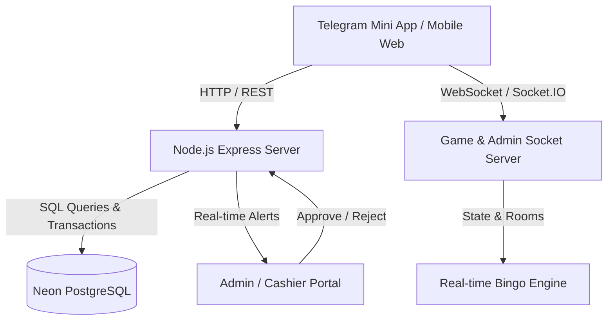

# Implementation Plan: Betika Bingo Mini-App & Payment Cashier System

## 1. System Overview

**Betika Bingo** is a high-concurrency, real-time multiplayer 75-ball bingo web application and Telegram Mini App (TMA). The platform delivers sub-second ball calls, interactive multi-card gameplay, localized audio announcements (Amharic & English), and seamless Ethiopian payment gateway processing (Telebirr and CBE Birr).

---

## 2. Core Architecture

### Technology Stack
- **Frontend**: React 19, TypeScript, Vite, Vanilla CSS & Modern Responsive Glassmorphism Design Tokens.
- **Backend / WebSockets**: Node.js, Express, Socket.IO, `tsx` runtime.
- **Database**: Serverless PostgreSQL (Neon) with connection pooling and atomic transactions.
- **Audio & Sound**: Web Audio API Sound Engine with multi-language voice packs (`/assets/audio/am/` and `/assets/audio/en/`).
- **Platform**: Telegram WebApp SDK Integration + Cross-platform Mobile Browsers.

---

## 3. Cashier & Deposit System

### 3.1 Payment Receiver Registry (`src/config/paymentReceivers.ts`)
The deposit system utilizes a centralized configuration for official merchant and personal receiver accounts, supporting automatic round-robin alternation and manual toggling to prevent account threshold limitations:

| Provider | Account ID | Account Name | Account Number | Badge / Priority |
| :--- | :--- | :--- | :--- | :--- |
| **Telebirr** | `tb_abduurehim` | **Abduurehim Sheycho** | `0952013863` | Account 1 (Primary) |
| **Telebirr** | `tb_mekonen` | **Mekonen Woldekidane** | `0998983344` | Account 2 (Secondary) |
| **CBE Birr** | `cbe_birr_yenegeta` | **Yenegeta atalay** | `0998983344` | CBE Birr Official |

### 3.2 Deposit Workflow
1. **Initiation**: Player selects payment method (Telebirr or CBE Birr) and amount (min 50 ETB, with quick presets: 50, 100, 200, 500, 1000, 5000 ETB).
2. **Account Presentation**: The active receiver details (e.g., **Abduurehim Sheycho - 09 52 01 38 63**) are clearly rendered with one-tap clipboard copy and an account-swapping control (`toggleTelebirrReceiver()`).
3. **Receipt Attachment**: Player uploads mobile screenshot of the transfer. The client automatically downscales and compresses the image via HTML5 Canvas before payload transmission.
4. **Submission**: Player inputs sender phone number and transaction reference (or receives an auto-generated tracking tag). Request is sent via `POST /api/wallet/deposit`.
5. **Real-time Admin Push**: The server broadcasts an `admin_new_deposit` event via Socket.IO directly to cashier terminals.
6. **Verification & Credit**: The cashier verifies the funds in the receiver account and approves the transaction via `POST /api/admin/deposits/:id/approve`. The user's wallet balance is credited atomically in PostgreSQL.

---

## 4. Multiplayer Game Loop

### 4.1 Room Types
- **Standard 75-Ball Room**: Classic 5x5 card grid with B-I-N-G-O columns.
- **Speed Bingo**: Rapid 3-second ball calls with real-time sphere sphere animations (`NextCallSphere.tsx`).
- **Pattern & Split Pot**: Automated winning pattern verification with fair pot splitting among concurrent winners.

### 4.2 Audio Commentary System
- Bilingual real-time speech announcements.
- Voice packs for Amharic numbers (1–75) and English callouts.
- Mute/unmute settings persisted in player local storage.

---

## 5. Security & Financial Integrity

- **Minimum Deposit Validation**: Strict backend threshold check (`amount >= 50 ETB`).
- **Duplicate Reference Prevention**: Unique constraint on `transaction_ref` in database avoids duplicate claim exploits.
- **Atomic Balance Updates**: Row-level locking on wallets during ticket purchasing and prize deposits.
- **Admin RBAC**: Protected cashier routes requiring authenticated admin bearer tokens.

---

## 6. Implementation Status & Roadmap

| Feature / Task | Status | Notes |
| :--- | :--- | :--- |
| **Telebirr Account 1 Update** | **COMPLETED** | Updated receiver to **Abduurehim Sheycho** (`0952013863`) |
| **Deposit Modal & Page Binding** | **COMPLETED** | Dynamic receiver binding & swap actions operational |
| **Bilingual Sound Engine** | **COMPLETED** | Amharic and English voice packs integrated |
| **PostgreSQL Atomic Ledger** | **COMPLETED** | Complete audit trails on all wallet mutations |
| **Automated SMS/Webhook Listener** | *Planned* | Direct Telebirr API webhook for instant approval |
| **Dynamic Room Scaler** | *Planned* | Auto-scaling rooms based on concurrent active players |
