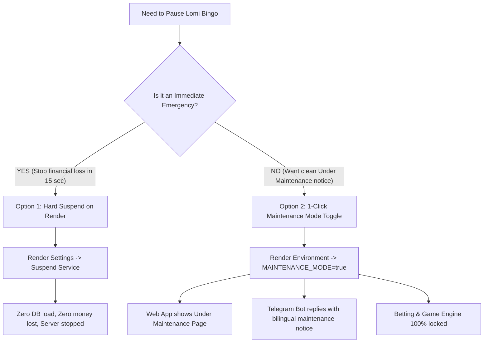

# Lomi Bingo - App Pause & Maintenance Mode Implementation Plan

## Executive Summary & Emergency Objectives

The client wants to pause the application immediately because:
1. **System cannot handle the current traffic spikes.**
2. **The platform is losing money / balances need protection.**
3. **Users need a clear, professional "Under Maintenance / በጊዜያዊ ጥገና ላይ ነን" notice** rather than a broken app.

---

## 2 Ways to Pause the Application



---

## Option 1: Emergency Hard Pause (Takes 15 Seconds)
> [!CAUTION]
> Use this if money is leaking **right now** and you must cut off all transactions immediately.

1. Open **[Render Dashboard](https://dashboard.render.com)**.
2. Click your web service: **`bingo-mini-app-hp80`**.
3. In the left navigation menu, click **Settings**.
4. Scroll to the very bottom of the page to the **Danger Zone**.
5. Click **"Suspend Service"** (or **"Suspend"**).
6. Confirm the prompt.

### Result:
* The Node.js server container is killed instantly.
* **0 games will run, 0 bets can be placed, and 0 money can be lost.**
* Database connection pool closes, stopping all Neon queries.
* *Note: Anyone who opens the web app will see Render's generic 503 "Service Suspended" page.*

---

## Option 2: Professional "Under Maintenance" Mode (Recommended)
> [!TIP]
> This keeps the server running cleanly so your brand looks professional, protects all player funds, and displays reassurance in Amharic & English.

### What happens in Maintenance Mode:
1. **Telegram Mini App**: Anyone opening the game sees a sleek, dark-themed **Under Maintenance Screen** with the Lomi Bingo logo, reassuring players that:
   > 🔒 **የእርስዎ ቀሪ ሂሳብ 100% ደህንነቱ የተጠበቀ ነው (All funds are safe)**
2. **Telegram Bot (`@LomiBingobot`)**: When players send `/start` or message the bot, it replies:
   > 🛠️ **ውድ ደንበኞቻችን፣ ሎሚ ቢንጎ በጊዜያዊ ጥገና ላይ ነው!** 🍋  
   > ስርዓታችንን ለማሻሻል እና የተሻለ አገልግሎት ለመስጠት ጨዋታው ለጥቂት ሰዓታት በጊዜያዊ ጥገና ላይ ይቆያል።  
   > 🔒 **የእርስዎ ቀሪ ሂሳብ እና ገንዘብ 100% ደህንነቱ የተጠበቀ ነው!**  
   > *(No "Play Game" button is provided)*
3. **Game Engine & Betting**: ALL ticket purchases (`handleBuyTicket`) and socket bets are **strictly blocked**.
4. **Admin Desk**: Remains accessible at `/admin` so you and the client can inspect balances, user counts, and financials.

### How to Activate Maintenance Mode:
1. Push the maintenance updates to GitHub:
   ```bash
   git add .
   git commit -m "feat: add maintenance mode guard and branded maintenance page"
   git push origin main
   ```
2. Go to **[Render Dashboard](https://dashboard.render.com)** $\rightarrow$ **`bingo-mini-app-hp80`** $\rightarrow$ **Environment**.
3. Add a new environment variable:
   * **Key**: `MAINTENANCE_MODE`
   * **Value**: `true`
4. Click **Save Changes**.

Render will redeploy/restart within ~40 seconds. Once restarted, all users will be presented with the maintenance screen and all betting will be frozen!

### How to Re-Open the App Later:
When the client is ready to resume live games:
1. Go to **Render Dashboard** $\rightarrow$ **Environment**.
2. Change `MAINTENANCE_MODE` to `false` (or delete it).
3. Click **Save Changes**.
4. The platform resumes normal operation instantly.

---

## 3. Investigating Why the Client is Losing Money

While the app is paused in Maintenance Mode, audit the following three key areas:

### 1. House Margin & Payout Percentage
* In standard bingo, the house takes **15% to 20%** commission on total pot stakes, and the remaining 80% to 85% goes to the winner.
* Verify `houseMargin` in [BingoGameEngine.ts](file:///c:/Users/asefa/Desktop/lomi-bingo/server/game/BingoGameEngine.ts) to ensure the house profit deduction is applied **before** calculating `winnerPayout`.

### 2. Standby / Dynamic Bot Balances vs Real Payouts
* Bots must never withdraw real ETB. Bot payouts are virtual and must be credited back to the house wallet.
* Ensure real users aren't triggering multiple cartela claims or duplicate bingo approvals on laggy connections.

### 3. Telegram Bonus Abuse
* Check if multiple fake accounts are farming the **10 ETB Welcome Bonus** without making deposits.
* In [auth.ts](file:///c:/Users/asefa/Desktop/lomi-bingo/server/routes/auth.ts), ensure phone number verification or single device restriction prevents multi-accounting.

---

## 4. Communication Broadcast (Optional)
If you want to notify all channel subscribers at once, you can post this message to your Telegram Channel (`@lomibingo_official`):

> 📢 **አስቸኳይ ማስታወቂያ ከሎሚ ቢንጎ** 🍋🛠️  
>  
> ውድ የሎሚ ቢንጎ ቤተሰቦች፤  
>  
> ከፍተኛ የተጫዋቾች ቁጥር በማስተናገድ ላይ በመሆናችን፣ የሰርቨር አቅማችንን ለማሳደግ እና የጨዋታ ልምዳችሁን ይበልጥ ፈጣን ለማድረግ መተግበሪያችን ለጥቂት ሰዓታት በጊዜያዊ ጥገና ላይ ይቆያል።  
>  
> 🔒 **የእርስዎ ቀሪ ሂሳብ እና ገንዘብ 100% ደህንነቱ የተጠበቀ ነው።**  
> ስራ እንደጨረስን ወዲያውኑ እናሳውቃችኋለን።  
>  
> ስለ ትዕግስታችሁ እናመሰግናለን! 🙏  
> 🇪🇹 **ሎሚ ቢንጎ**
