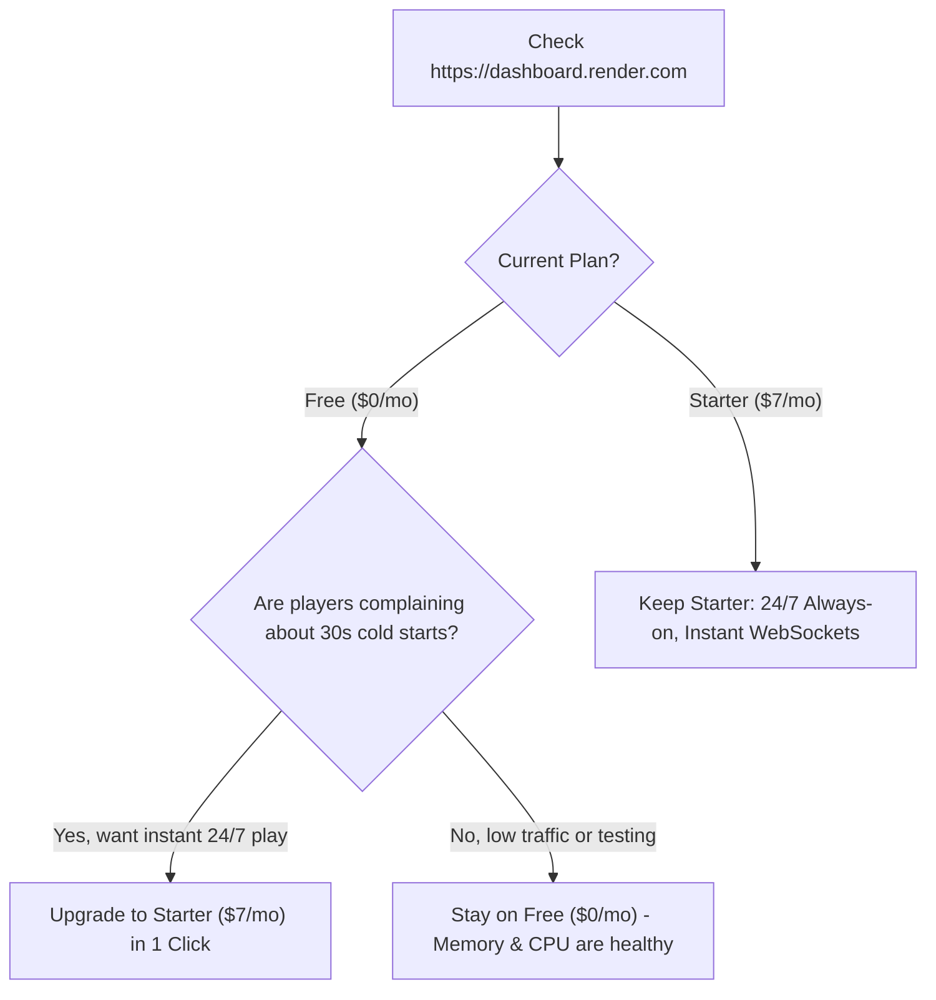

# Render Hosting Plan & Resource Audit Guide (Lomi Bingo)

This guide provides a step-by-step plan to check your active **Render Hosting Plan**, inspect live resource metrics (RAM, CPU, Bandwidth), understand billing limits, and evaluate if the Free tier is sufficient for your platform.

---

## 1. Quick Summary of Your Render Service

| Parameter | Value |
|---|---|
| **Production URL** | `https://bingo-mini-app-30pe.onrender.com` |
| **Service Type** | Web Service (Node.js + Express + Socket.IO + Vite Static) |
| **Auto-Deploy Status** | **ACTIVE** (Directly tracking `origin/main` on GitHub) |
| **Latest Deployed Version** | `20261022_PROD` |
| **Reverse Proxy / SSL** | Cloudflare CDN + Render Automatic SSL TLSv1.3 |

---

## 2. Step-by-Step: How to Check Your Render Plan

### Step 1: Open Render Dashboard
1. Go to **[https://dashboard.render.com](https://dashboard.render.com)**.
2. Log in using your GitHub account or Render credentials.

### Step 2: Select Your Web Service
1. On your Dashboard homepage, find your web service named **`bingo-mini-app-30pe`** (or similar).
2. Click on it to open the service overview.

### Step 3: Check Your Active Plan & Instance Type
1. In the left navigation menu, click **Settings**.
2. Scroll down to the **Instance Type** section.
3. You will see which plan is currently selected:
   - **Free ($0/month)**: 512 MB RAM, 0.1 CPU.
   - **Starter ($7/month)**: 512 MB RAM, 0.5 CPU (Always-on, never sleeps).
   - **Standard ($25/month)**: 2 GB RAM, 1 CPU.

### Step 4: Check Live RAM & CPU Metrics
1. In the left navigation menu, click **Metrics**.
2. Review the live usage graphs:
   - **Memory Usage (RAM)**:
     - Normal Lomi Bingo Node.js consumption is **~85 MB to 130 MB**.
     - On the Free tier (512 MB max), you are utilizing only **~20%–25%**, which is well within safe limits.
   - **CPU Usage**:
     - Shows spike levels during draw ticks and game room cycles. Typically < 5–10%.
   - **HTTP Requests**:
     - Displays incoming request volume and HTTP status codes (2xx, 3xx).

### Step 5: Check Outbound Bandwidth & Billing
1. Click your profile avatar / account name at the top right of the screen.
2. Select **Billing** $\rightarrow$ **Usage**.
3. Review your monthly consumption:
   - **Outbound Bandwidth**: Free tier includes **100 GB/month** (Render bandwidth is separate from Neon DB transfer).
   - **Build Minutes**: Free tier includes **500 build minutes/month**.

---

## 3. Render Plan Comparison for Lomi Bingo

| Feature | Free Tier ($0/month) | Starter Tier ($7/month) | Standard Tier ($25/month) |
|---|---|---|---|
| **Monthly Cost** | **$0.00** | **$7.00** | **$25.00** |
| **RAM (Memory)** | 512 MB | 512 MB | 2,048 MB (2 GB) |
| **CPU** | 0.1 CPU | 0.5 CPU (5x faster) | 1.0 CPU |
| **Instance Sleep** | **Spins down after 15 min idle** | **Never sleeps (Always-on 24/7)** | **Never sleeps (Always-on 24/7)** |
| **Wake-up Delay** | ~30–50s on first load | **Instant (< 100ms response)** | **Instant (< 100ms response)** |
| **WebSockets** | Supported (interrupted if sleep) | **Uninterrupted 24/7** | **Uninterrupted 24/7** |
| **Bandwidth** | 100 GB / month included | 100 GB / month included | 100 GB / month included |
| **Custom Domains** | Fully Supported | Fully Supported | Fully Supported |
| **Best For** | Testing & early beta | **Live players & cash game rooms** | **High traffic (5,000+ concurrent)** |

---

## 4. Key Factors to Consider for Your App

### Factor A: Spin-Down & Cold Starts (Free Tier Behavior)
- **What happens on Render Free Tier**:
  - If no player accesses the app for 15 minutes, Render puts the container to sleep to save cloud resources.
  - When the next player opens the app or Telegram bot, Render must boot the container up, which takes **30 to 50 seconds**.
- **Impact on Real-Money Bingo**:
  - If the server goes to sleep, players opening the bot might see a loading spinner for 30 seconds before the game appears.
  - Once awake, the server runs fast and smoothly.

### Factor B: Memory (RAM) Safety
- On the Free tier, Render allows up to **512 MB**.
- If a Node.js process exceeds 512 MB, Render restarts the container (OOM Kill).
- **Lomi Bingo Status**: Our Node.js footprint is lean (~90–120 MB RAM) because game tickets and cartela matrices are generated deterministically in memory, and heavy screenshots are now streamed on demand.
- **Verdict**: RAM is **100% safe** on both Free and Starter plans.

### Factor C: Outbound Bandwidth
- Render provides **100 GB / month** of outbound web bandwidth for free.
- Unlike Neon's 5.0 GB limit, 100 GB on Render is very generous and virtually impossible to exceed with normal gameplay.

---

## 5. Recommended Decision Path

1. **If you are currently on the Free Tier ($0/mo)**:
   - Check if the 30-second wake-up time is acceptable for your current testing phase.
   - If acceptable: **Stay on Free**. You will incur $0 costs.
   - If you want immediate, instant 24/7 responsiveness for Telegram users without sleep delays: **Upgrade to Starter ($7/month)** under `Settings` $\rightarrow$ `Instance Type`.

2. **If you are already on the Starter Tier ($7/mo)**:
   - Your service will never sleep, WebSockets will remain connected 24/7, and you have ample resources for hundreds of concurrent players.

---

## 6. How to Upgrade in 1 Click (If Desired)

1. Go to **`https://dashboard.render.com`**.
2. Click your service: **`bingo-mini-app-30pe`**.
3. Click **Settings** in the left sidebar.
4. Scroll to **Instance Type**.
5. Select **Starter ($7/mo)**.
6. Click **Save Changes**.
7. Render upgrades your instance seamlessly without downtime.
