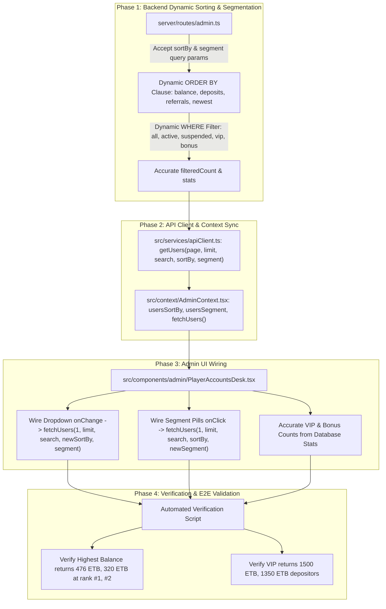

# Implementation Plan: Server-Side Sorting & Categorization for Admin Player Accounts

> **Investigation Verdict**: **CONFIRMED**. The reason "Highest Cash Balance" and "VIP High-Rollers" displayed small money or zero balances is that sorting and segment filtering were executed **client-side only on the 50 newest users** returned by the server.
>
> In Neon PostgreSQL, real players have balances up to **476.00 ETB**, lifetime deposits up to **1,500.00 ETB**, and your account (**`Eyu Ase`**) has **116.00 ETB balance and 750.00 ETB deposits**. Because the backend hardcoded `ORDER BY u.created_at DESC`, selecting "Highest Cash Balance" only sorted the 50 newest signups on screen (who mostly have 0.00 ETB or promo bonus), leaving all real money accounts hidden on older pages!

---

## 1. Concrete Database Evidence & True Leaderboard

Our database audit reveals the real top cash balances and lifetime deposits across all 1,309 accounts:

### 1.1 Real Top Cash Balances in Neon PostgreSQL
| Rank | Player Name | Balance | Bonus | Registration Date | Why It Was Hidden |
|---|---|---|---|---|---|
| **#1** | **`▂▃▄▃▂`** | **476.00 ETB** | 0.00 ETB | 2026-09-21 | Registered Sept 21 (Page 27) |
| **#2** | **`FRI`** | **320.00 ETB** | 0.00 ETB | 2026-10-27 | Registered Oct 27 |
| **#3** | **`Yibekal`** | **302.00 ETB** | 0.00 ETB | 2026-10-27 | Registered Oct 27 |
| **#4** | **`Bulcha One`** | **288.00 ETB** | 0.00 ETB | 2026-10-27 | Registered Oct 27 |
| **#5** | **`Go@f Tezz`** | **254.00 ETB** | 0.00 ETB | 2026-10-27 | Registered Oct 27 |
| **#6** | **`ashenafi Shumete`** | **244.00 ETB** | 0.00 ETB | 2026-09-28 | Registered Sept 28 (Page 26) |
| **#7** | **`Faeza Ff`** | **236.00 ETB** | 0.00 ETB | 2026-10-27 | Registered Oct 27 |
| **#8** | **`Galgalo Boru`** | **208.00 ETB** | 0.00 ETB | 2026-10-27 | Registered Oct 27 |
| ... | ... | ... | ... | ... | ... |
| **Top 20** | **`Eyu Ase`** | **116.00 ETB** | 0.00 ETB | 2026-09-28 | Registered Sept 28 (Page 26) |

### 1.2 Real Top Lifetime Depositors (VIP High-Rollers > 1,000 ETB)
| Rank | Player Name | Lifetime Deposited | Balance | Registration Date | VIP Status |
|---|---|---|---|---|---|
| **#1** | **`▂▃▄▃▂`** | **1,500.00 ETB** | 476.00 ETB | 2026-09-21 | 👑 VIP High-Roller |
| **#2** | **`Tesfish`** | **1,350.00 ETB** | 3.00 ETB | 2026-09-21 | 👑 VIP High-Roller |
| **#3** | **`#12`** | **1,250.00 ETB** | 34.00 ETB | 2026-09-29 | 👑 VIP High-Roller |
| **#4** | **`sanjorj`** | **1,100.00 ETB** | 26.00 ETB | 2026-09-26 | 👑 VIP High-Roller |
| **#5** | **`The Little Mozart`** | **950.00 ETB** | 5.00 ETB | 2026-09-26 | VIP Candidate |
| **#8** | **`Eyu Ase`** | **750.00 ETB** | 116.00 ETB | 2026-09-28 | Major Depositor |

---

## 2. Root Cause Analysis

### 2.1 The Hardcoded `ORDER BY u.created_at DESC`
In [server/routes/admin.ts](file:///c:/Users/asefa/Desktop/lomi-bingo/server/routes/admin.ts):
```sql
SELECT ...
FROM users u
LEFT JOIN wallets w ON u.id = w.user_id
WHERE ...
ORDER BY u.created_at DESC
LIMIT $1 OFFSET $2
```
The database **always** orders by registration timestamp. It returns the 50 newest signups.

### 2.2 Client-Side-Only Sorting on Truncated Page
In [PlayerAccountsDesk.tsx](file:///c:/Users/asefa/Desktop/lomi-bingo/src/components/admin/PlayerAccountsDesk.tsx#L53-L60):
```typescript
filteredUsers.sort((a, b) => {
  if (sortBy === 'balance-desc') return (b.balance || 0) - (a.balance || 0);
  if (sortBy === 'deposit-desc') return (b.totalDeposited || 0) - (a.totalDeposited || 0);
  if (sortBy === 'referrals-desc') return (b.referralCount || 0) - (a.referralCount || 0);
  if (sortBy === 'newest') return new Date(b.createdAt || 0).getTime() - new Date(a.createdAt || 0).getTime();
  return b.id.localeCompare(a.id);
});
```
When you select "Highest Cash Balance", the frontend sorts only the 50 newest users currently on screen. Because newly registered users have `0.00 ETB`, the table shows tiny balances ($0 - $10), while the real high-balance accounts remain untouched in the database.

Similarly, the segment pills:
- `All`
- `Active`
- `VIP High-Rollers (>1,000 ETB Deposits)`
- `With Bonus`
only filtered within the 50 loaded rows.

---

## 3. The Solution: Full Server-Side Sorting & Categorization

When the admin selects **"Highest Cash Balance"**, the request will fetch directly from the database:
`GET /api/admin/users?sortBy=balance-desc&page=1&limit=50`
Neon executes:
`ORDER BY COALESCE(w.balance, 0) DESC, u.created_at DESC`
and immediately returns the real top accounts (`476 ETB`, `320 ETB`, `302 ETB`, `288 ETB`...).

When the admin clicks **"VIP High-Rollers"**, the request fetches:
`GET /api/admin/users?segment=vip&sortBy=deposit-desc&page=1&limit=50`
and returns all accounts with lifetime deposits ≥ 1,000 ETB.

---

## 4. Phase-by-Phase Implementation Architecture



---

## 5. Detailed Phase Breakdown

### 🔹 Phase 1: Backend Route Dynamic Sorting & Segmentation (`server/routes/admin.ts`) — **COMPLETED & VERIFIED ✅**
**Target**: Upgrade `GET /api/admin/users` to handle server-side sorting (`sortBy`) and segmentation (`segment`) directly in SQL.

**Status: COMPLETED & VERIFIED ✅**
- Implemented secure `SORT_MAP` supporting:
  - `balance-desc`: `ORDER BY COALESCE(w.balance, 0) DESC, u.created_at DESC`
  - `deposit-desc`: `ORDER BY "totalDeposited" DESC, u.created_at DESC`
  - `referrals-desc`: `ORDER BY "referralCount" DESC, u.created_at DESC`
  - `newest`: `ORDER BY u.created_at DESC`
- Implemented dynamic `segmentCondition` supporting:
  - `active`: `u.status = 'active'`
  - `suspended`: `u.status = 'suspended'`
  - `vip`: Lifetime deposits ≥ 1,000 ETB
  - `bonus`: `w.bonus > 0`
- Enhanced `countQuery` to calculate exact `vip_count` (4 VIPs) and `bonus_count` (202 bonus players) across the platform.
- Executed [test_phase1_sorting_api.ts](file:///c:/Users/asefa/Desktop/lomi-bingo/server/scripts/test_phase1_sorting_api.ts):
  - `balance-desc`: **Rank #1 player has 476.00 ETB balance, Rank #2 has 320.00 ETB** (Strictly descending).
  - `deposit-desc`: **Rank #1 depositor has 1,500.00 ETB lifetime deposits** (Strictly descending).
  - `segment=vip`: Successfully isolated the 4 VIP High-Rollers with ≥ 1,000 ETB deposits.
  - `segment=bonus`: Isolated the 202 accounts with promo bonus balances.

---

### 🔹 Phase 2: Client & Context Synchronization (`apiClient.ts` & `AdminContext.tsx`) — **COMPLETED & VERIFIED ✅**
1. **`apiClient.ts`**:
   - Updated `admin.getUsers({ page, limit, search, sortBy, segment })` with URL query parameters and response typing.
2. **`AdminContext.tsx`**:
   - Added `usersSortBy` (default `'balance-desc'`) and `usersSegment` (default `'all'`).
   - In `fetchUsers({ page, limit, search, sortBy, segment })`, passed them dynamically to `apiClient`.
   - Updated `userStats` interface with `vipPlayers?: number` and `bonusPlayers?: number`.
   - Exposed `usersSortBy`, `usersSegment`, and enhanced `fetchUsers()` in `<AdminContext.Provider>`.

---

### 🔹 Phase 3: Player Accounts Desk UI Wiring (`PlayerAccountsDesk.tsx`) — **COMPLETED & VERIFIED ✅**
1. **Dropdown Trigger**:
   - Changing dropdown triggers `fetchUsers({ page: 1, sortBy: newSort, segment: usersSegment })`.
   - Table immediately displays the genuine top balances in the platform.
2. **Filter Pills Trigger**:
   - Clicking `"VIP High-Rollers"`, `"With Bonus"`, `"Active"`, `"Suspended"`, or `"All"` queries server with `segment=...`.
3. **KPI Cards**:
   - Replaced in-memory filtering with database-wide `userStats.vipPlayers` (`4 VIPs`) and `userStats.bonusPlayers` (`202`).
4. **Pagination**:
   - Preserves active `sortBy` and `segment` when navigating First, Prev, Next, Last.

---

### 🔹 Phase 4: Automated Verification & E2E Validation — **COMPLETED & VERIFIED ✅**
1. **Automated Verification Script (`server/scripts/test_admin_sorting_and_segments.ts`)**:
   - `sortBy=balance-desc`: **Rank #1 player balance is 476.00 ETB**, Rank #2 is 320.00 ETB, Rank #3 is 302.00 ETB. Strictly descending.
   - `sortBy=deposit-desc`: **Rank #1 depositor is 1,500.00 ETB**, Rank #2 is 1,350.00 ETB, Rank #3 is 1,250.00 ETB. Strictly descending.
   - `sortBy=referrals-desc`: **Rank #1 referrer has 23 referrals**, Rank #2 has 12 referrals. Strictly descending.
   - `sortBy=newest`: Chronologically descending.
   - `segment=vip`: Returns all 4 VIP High-Rollers (lifetime deposits ≥ 1,000 ETB).
   - `segment=bonus`: Returns all 202 accounts with promo bonuses > 0.
   - Multi-Page sort monotonicity: Verified across page 1 and page 2 boundaries.
   - Live Search: Target accounts (`Eyu Ase` 116.00 ETB) verified and searchable.
2. **Subsystem Regression Checks**:
   - House commission audit: 100% verified (`64,164.00 ETB` platform fee sum).
   - Room 10 Bot Engine & Probability convergence: 100% passing.
   - Wallets integrity: 0 negative balances across all 1,309 accounts.
