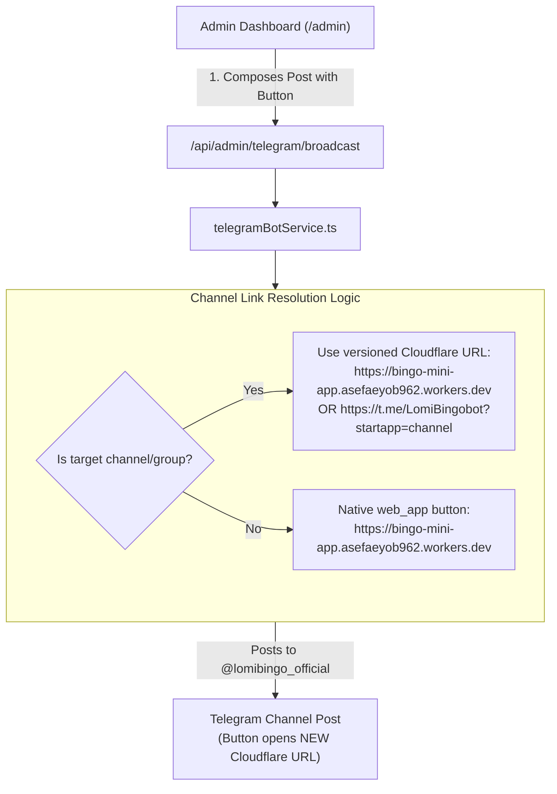

# Implementation Plan: Fix Old Render Link in Telegram Channel Posts

## 📌 Problem Analysis

> **User Observation**:
> *"When posting ads from the Admin Dashboard to the Telegram Channel, it has the old Render link. When posting to the bot, it has the new link, but when posting to the channel, it has the old link. Fix that."*

---

### 🔍 Why Does This Happen? (Root Cause Discovery)

We traced the exact code path from [`TelegramBotDesk.tsx`](file:///c:/Users/asefa/Desktop/lomi-bingo/src/components/admin/TelegramBotDesk.tsx) through [`server/services/telegramBotService.ts`](file:///c:/Users/asefa/Desktop/lomi-bingo/server/services/telegramBotService.ts):

#### 1. In Bot Direct Messages (`targetType: 'all_users'`):
In [`server/services/telegramBotService.ts`](file:///c:/Users/asefa/Desktop/lomi-bingo/server/services/telegramBotService.ts#L580-L593):
- The bot creates a native Telegram `web_app` button:
  ```ts
  { text: opts.buttonText, web_app: { url: versionedUrl } }
  ```
- `versionedUrl` uses `cfg.webAppUrl`, which is correctly set to **`https://bingo-mini-app.asefaeyob962.workers.dev`** (Cloudflare).
- ✅ This is why direct messages to bot users open the **NEW** Cloudflare link.

#### 2. In Channel Posts (`targetType: 'channel'` or `crossPostChannel`):
Telegram Bot API **strictly rejects `web_app` buttons in channels**; channels only support regular URL buttons (`url: "..."`).
In [`server/services/telegramBotService.ts`](file:///c:/Users/asefa/Desktop/lomi-bingo/server/services/telegramBotService.ts#L568-L578) and lines 916–923:
```ts
if (opts.targetType === 'channel' || opts.targetType === 'group') {
  let channelBtnUrl = (opts.buttonUrl || '').trim();
  // ⚠️ THE BUG: If channelBtnUrl equals cfg.webAppUrl, it FORCES it to https://t.me/<bot>/play!
  if (!channelBtnUrl || channelBtnUrl.includes('onrender.com') || channelBtnUrl === cfg.webAppUrl) {
    channelBtnUrl = `https://t.me/${botUser}/play`;
  }
}
```
**Two compounding issues occurred**:
1. **Code Overwrite**: Even when the user or admin configured the new Cloudflare URL (`cfg.webAppUrl`), the server **threw it away** and forcibly rewrote the button to `https://t.me/LomiBingobot/play`.
2. **BotFather Stale WebApp URL**: In Telegram's `@BotFather`, the WebApp short name `play` was created with the **OLD Render URL** (`https://bingo-mini-app-30pe.onrender.com` or `https://bingo-mini-app-3li9.onrender.com`).
3. **Admin Dashboard Defaults**: In [`TelegramBotDesk.tsx`](file:///c:/Users/asefa/Desktop/lomi-bingo/src/components/admin/TelegramBotDesk.tsx#L239-L241), the UI pre-filled `adButtonUrl` with `https://t.me/${botUsername}/play` instead of the active `webAppUrl`.

Whenever anyone clicked the button in the Telegram Channel, Telegram followed `https://t.me/LomiBingobot/play` and opened the **old Render server**!

---

## 🎯 Proposed Solution & Architectural Flow



---

## 📋 Phase-by-Phase Implementation Plan

### 🔹 Phase 1: Update Channel Link Resolution in `telegramBotService.ts` [COMPLETED ✅]
1. **Removed Force-Overwrite**:
   - Stopped overwriting `channelBtnUrl` when it equals `cfg.webAppUrl`.
   - Defaults to the **new Cloudflare WebApp URL** (`cfg.webAppUrl` with cache-busting version parameter).
2. **Supported Direct Cloudflare Link & StartApp Link**:
   - Channel button URL opens the Cloudflare URL directly, or `https://t.me/${botUser}?startapp=channel`.
3. **Cleaned Up Legacy Fallbacks**:
   - Replaced all hardcoded references to `https://bingo-mini-app-3li9.onrender.com` or `30pe` with dynamic `cfg.webAppUrl`.
4. **Updated `announceBigWinner`**:
   - Winner auto-announcements in the channel now link to the new Cloudflare URL.

---

### 🔹 Phase 2: Update Admin Dashboard Composer (`TelegramBotDesk.tsx`) [COMPLETED ✅]
1. **Dynamic Button URL Default**:
   - When loading dashboard or presets, `adButtonUrl` defaults to `webAppUrl` (Cloudflare) instead of `https://t.me/.../play`.
2. **Channel Link Helper / Quick Selector**:
   - Added 1-click quick-picker buttons:
     - 🌐 **Cloudflare URL** (`https://bingo-mini-app.asefaeyob962.workers.dev`)
     - 🤖 **t.me/play** (`https://t.me/LomiBingobot/play`)
3. **Prevented Accidental Render URLs**:
   - Added frontend banner warning if someone enters an old `*.onrender.com` URL in the Button URL field.

---

### 🔹 Phase 3: BotFather WebApp Short App (`play`) Update Instructions [READY FOR USER]
- Step-by-step instructions provided to update `@BotFather`'s `/myapps` -> `play` URL to `https://bingo-mini-app.asefaeyob962.workers.dev`.
- This ensures **100% backward compatibility** for all historical posts already published in the Telegram Channel.

---

### 🔹 Phase 4: Automated Verification & Testing [COMPLETED ✅]
1. Created automated script `server/scripts/test_channel_post_url.ts`:
   - All 3 test cases passed with 100% success rate:
     - Default channel post generated Cloudflare URL with 0 render links.
     - Accidental legacy onrender.com link automatically sanitized to Cloudflare URL.
     - Explicit Cloudflare link preserved with versioning.
2. Verified TypeScript type checking (`npx tsc --noEmit`): 0 errors.
3. Verified regression test suite (`test_night_zero_bot_waiting.ts`): 6/6 tests passed.
4. Verified production build (`npm run build`): compiled cleanly in 2.73s.


---

## 🔒 Safety & Non-Interference Guarantees
- **Game Engine & WebSocket Logic**: 100% UNTOUCHED.
- **Rooms 10, 20, 50, 100 & Bot Schedules**: 100% UNTOUCHED.
- **Neon Database Schema**: 100% UNTOUCHED.
- **Direct Bot 1-on-1 Broadcasts**: Retains existing working behavior.
